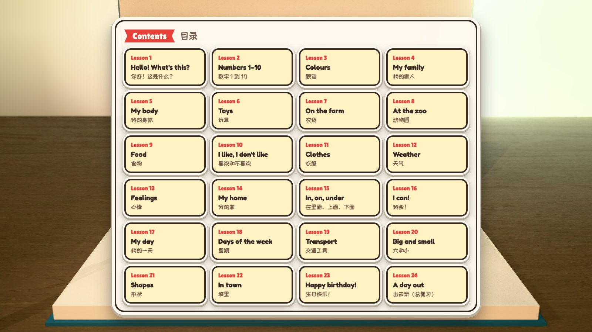
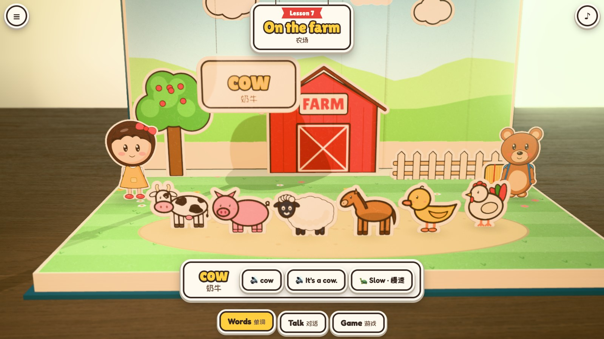

# Pop-up English · 立体书英语

An interactive pop-up book for learning English, made for kindergarten and early primary school children (age 4–8). It runs in the browser. Paper characters and pictures pop up from a 3D book on a desk, and every word and sentence can be heard.

一本能点、能听、会弹起来的立体书英语课本，给幼儿园到小学低年级的小朋友用。在浏览器里打开就能玩，24 课学完大约到 A1 水平。

**▶ Play online · 在线打开: https://dino-cute.github.io/Kindergarten/**




## Features · 功能

- **24 lessons, about 150 words, A1 level.** Words and sentence patterns follow the Cambridge Pre A1 Starters / A1 Movers word lists.
  24 课，约 150 个核心词，参考剑桥少儿英语 Starters / Movers 词表。
- **Three modes in every lesson · 每课三种玩法**
  - **Words 单词**: tap a picture to hear the word and a sentence. There is also a slow mode. 点图片听单词和例句，可以慢速。
  - **Talk 对话**: Kiki and Momo act out a short dialogue with speech bubbles. Kiki 和 Momo 演一段小对话。
  - **Game 游戏**: listen and tap the right picture to earn stars. 听音找图，答对得星星。
- **Two original characters**: Kiki (a girl with a red bow) and Momo (a little brown bear).
  两个原创角色：扎红蝴蝶结的小女孩 Kiki 和小熊 Momo。
- **738 recorded voice clips**, paper sound effects and a music box. Works fully offline after download.
  738 段发音、纸片音效和音乐盒，下载后不联网也能用。

## How to run · 怎么打开

The page uses ES modules, so it must be served over `http://` (opening `index.html` by double-click will not work).
页面用了 ES 模块，需要通过本地服务器打开，直接双击 `index.html` 打不开。

**macOS / Linux**

```sh
git clone https://github.com/dino-cute/Kindergarten.git
cd Kindergarten
./start.sh            # opens http://localhost:8796
```

**Any system with Python 3 · 任何装了 Python 3 的电脑**

```sh
python3 -m http.server 8796
# then open http://localhost:8796 in Chrome / Edge / Safari
```

It also works on phones and tablets: run the server on a computer, then open `http://<computer-ip>:8796` on a device in the same Wi‑Fi.
手机、平板也能用：电脑上起服务，同一 Wi‑Fi 下的设备打开 `http://<电脑IP>:8796`。

**URL options · 网址参数**

| Option | Meaning |
|---|---|
| `?lesson=7` | Open the book and go straight to lesson 7 · 直接进入第 7 课 |
| `?lite` | Lower render resolution for older devices · 老设备降低分辨率 |

## Lessons · 课表

| # | Lesson | 课题 | Words |
|---|---|---|---|
| 1 | Hello! What's this? | 你好！这是什么？ | bag, book, pen, pencil, ruler, eraser |
| 2 | Numbers 1–10 | 数字 1 到 10 | one, two, three, four, five, six, seven, eight, nine, ten |
| 3 | Colours | 颜色 | red, blue, yellow, green, orange, purple, pink, brown |
| 4 | My family | 我的家人 | dad, mum, grandpa, grandma, brother, sister |
| 5 | My body | 我的身体 | head, eyes, ears, nose, mouth, hands, legs, feet |
| 6 | Toys | 玩具 | ball, car, doll, kite, robot, train |
| 7 | On the farm | 农场 | cow, pig, sheep, horse, duck, chicken |
| 8 | At the zoo | 动物园 | lion, tiger, elephant, monkey, giraffe, zebra |
| 9 | Food | 食物 | apple, banana, bread, egg, milk, rice |
| 10 | I like, I don't like | 喜欢和不喜欢 | carrot, fish, pizza, juice, chocolate, tomato |
| 11 | Clothes | 衣服 | hat, coat, dress, skirt, shoes, socks |
| 12 | Weather | 天气 | sunny, cloudy, rainy, windy, snowy, rainbow |
| 13 | Feelings | 心情 | happy, sad, angry, tired, hungry, scared |
| 14 | My home | 我的家 | bed, chair, table, sofa, lamp, window |
| 15 | In, on, under | 在里面、上面、下面 | cat, box, in, on, under, behind |
| 16 | I can! | 我会！ | run, jump, swim, fly, climb, sing |
| 17 | My day | 我的一天 | get up, breakfast, school, play, dinner, bed |
| 18 | Days of the week | 星期 | Monday, Tuesday, Wednesday, Thursday, Friday, Saturday, Sunday |
| 19 | Transport | 交通工具 | bus, car, bike, train, plane, boat |
| 20 | Big and small | 大和小 | big, small, long, short, fast, slow |
| 21 | Shapes | 形状 | circle, square, triangle, rectangle, star, heart |
| 22 | In town | 城里 | shop, school, park, hospital, cafe, house |
| 23 | Happy birthday! | 生日快乐！ | cake, candle, present, balloons, party hat, card |
| 24 | A day out | 出去玩（总复习） | sunny, bus, duck, kite, ball, apple |

## Project structure · 目录

```
index.html, style.css   page and styles
js/app.js               app flow: book, contents, Words / Talk / Game modes
js/lessons.js           all 24 lessons (words, sentences, dialogues, games)
js/art*.js, draw.js     characters and word pictures, drawn in code
js/book.js, paper.js,
cutmesh.js, post.js,
lib.js                  pop-up book engine (three.js)
js/sound.js             Web Audio: voices, sound effects, music box
audio/                  voice clips (mp3)
assets/                 HDRI, desk texture, desk lamp model
fonts/                  web fonts
vendor/three/           three.js r170 (only the files used)
start.sh                local server
```

## Credits · 致谢

- Characters, word pictures and scenes are original, drawn in code.
- three.js r170 (MIT) · Poly Haven assets (CC0): Lythwood Lounge HDRI, American Walnut Veneer, Desk Lamp Arm 01.
- Fonts (SIL OFL 1.1): Fredoka, Lilita One, ZCOOL KuaiLe.
- Voices generated with Microsoft Edge neural TTS (en-US-AvaNeural, en-US-AnaNeural).
- Visual style inspired by the `paper-popup` style of Lemo-Opuscar.

See [CREDITS.md](CREDITS.md) for details.
